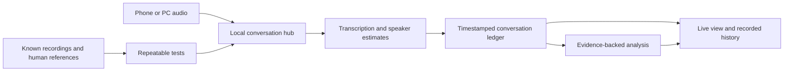

# Socio Studios

### Tools for understanding conversations. Experiments in how we connect.

Socio Studios brings together conversational software, interactive experiments,
and the work of showing how they are made.

Our first project is **re:morse**: a local-first conversation journal connecting
speech, speaker turns, transcripts, and evidence-backed analysis.
The aim is to make a conversation inspectable as it unfolds and replayable afterward.

**Research prototype.** Fast output is not the same as accurate understanding.
We publish limitations alongside demonstrations and measurements.

---

## The studio

| Project | Purpose | Current stage |
| --- | --- | --- |
| **re:morse** | Desktop conversation hub, live transcript, history, and analysis | Working prototype; accuracy and reliability work ongoing |
| **Companion** | Android phone capture and optional wearable controls | Development; source consolidation pending |
| **Conversation playground** | Recorded meetings, reference transcripts, speaker timings, repeatable evaluation | Implemented within re:morse; public packaging pending |
| **Games** | Interactive experiments around conversation and participation | Planned |
| **Media** | Development demonstrations, YouTube work, and project explanations | Planned |

The projects share a direction, not a release status. This page does not imply
that every component is downloadable or ready for everyday use.

## What re:morse is trying to make possible

- Follow who spoke, when, and through which microphone.
- Revisit the words and available audio behind an interpretation.
- Trace questions, topic returns, concerns, and connections across a conversation.
- Compare model output against known recordings rather than trust a convincing label.
- Offer optional, private feedback without turning a conversation into a moral score.

A device is not a speaker. A topic label is not a fact.
Emotional interpretations are uncertain and must not be presented as mind-reading.

## How the pieces fit

## The first demonstration

A recorded meeting is the starting point: select an utterance, hear its audio,
inspect its reference speaker, and compare the system's predictions.
Then repeat the same test after changing a model or processing setting.

The current development library contains **three complete AMI meetings and 804
playable grouped utterances**. Initial short-span tests exposed substantial word
and speaker errors. Those are problems to solve, not numbers to hide.

AMI recordings and annotations are attributed to the
[AMI Meeting Corpus](https://groups.inf.ed.ac.uk/ami/corpus/) under CC BY 4.0.
The recordings are not hosted in this profile repository.

## Follow the work

- [Project map](https://github.com/socio-studios/.github/blob/main/PROJECTS.md)
- [Delivery roadmap](https://github.com/socio-studios/.github/blob/main/ROADMAP.md)
- [How to contribute](https://github.com/socio-studios/.github/blob/main/CONTRIBUTING.md)
- [Studio repositories](https://github.com/orgs/socio-studios/repositories)

Public source releases and a standalone studio website are being prepared.
Repository visibility alone does not establish an open-source license;
each project's license will state its terms.

---

**Local-first. Evidence before interpretation. Measured progress.**

Do not post private recordings, transcripts, credentials, or identifying voice
samples in public issues. Use synthetic examples or appropriately licensed data.
